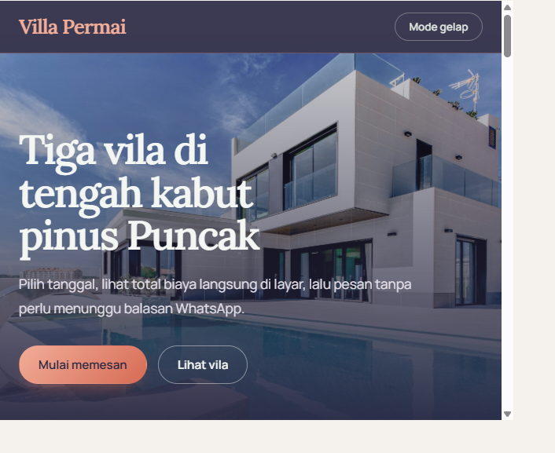
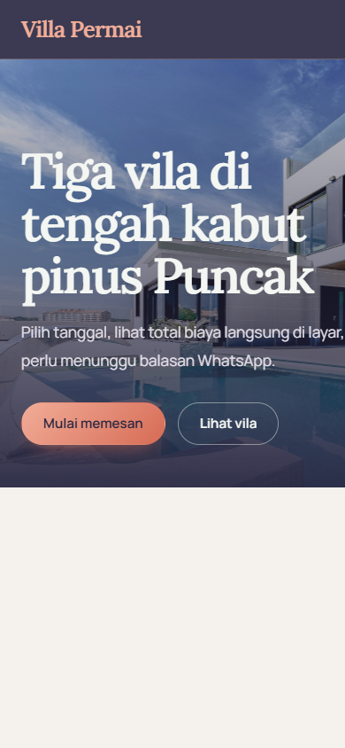

# Villa Permai

Website pemesanan vila di Puncak, Kabupaten Bogor. Pengunjung dapat melihat pilihan vila, memeriksa ketersediaan, dan memperkirakan biaya sebelum memesan. Dibuat dengan HTML, CSS, dan JavaScript tanpa server atau basis data.

## Identitas

- **Nama:** Ade Evan Alviansyah
- **NIM:** 24011130331
- **Mata kuliah:** Teknologi Web (UTS)

## Repository

[github.com/maulvinazir87-cmd/UTS_FalzaYahya_VillaPermai](https://github.com/maulvinazir87-cmd/UTS_FalzaYahya_VillaPermai)

## Dokumentasi tampilan

### Tampilan web

<a href="./assets/dokumentasi-web.png">
  
</a>

### Tampilan mobile

<a href="./assets/dokumentasi-mobile.png">
  
</a>

Klik gambar untuk melihat tangkapan layar ukuran penuh.

## Fitur

- Tiga pilihan vila dengan foto, fasilitas, kapasitas, dan harga.
- Pencarian, pengurutan, dan filter ketersediaan vila.
- Pemeriksaan ketersediaan berdasarkan tanggal.
- Ringkasan biaya otomatis, validasi formulir, dan deteksi bentrok jadwal.
- Penyimpanan nama, pesanan, favorit, dan preferensi tema di `localStorage`.
- Konfirmasi pesanan melalui WhatsApp.
- Tampilan responsif dan pilihan tema terang atau gelap.

## Perhitungan biaya

```text
sewa           = harga per malam x jumlah malam
akhir pekan    = harga per malam x 15% x jumlah malam Jumat dan Sabtu
tamu tambahan  = (jumlah tamu - 4) x Rp75.000 x jumlah malam (jika tamu lebih dari 4)
diskon         = (sewa + akhir pekan) x 10% (jika menginap 3 malam atau lebih)

total          = sewa + akhir pekan + tamu tambahan - diskon
```

Harga berlaku per unit vila. Jumlah tamu tidak boleh melebihi kapasitas vila.

## Menjalankan proyek

Buka `index.html` di browser atau gunakan ekstensi Live Server di VS Code. Tidak perlu proses build maupun instalasi dependensi.

## Struktur proyek

```text
index.html
style.css
script.js
README.md
assets/
  vila-1.jpg
  vila-2.jpg
  vila-3.jpg
  dokumentasi-web.png
  dokumentasi-mobile.png
```

Foto vila diunduh dari Unsplash dan disimpan lokal di folder `assets`. Sumber foto dapat dilihat di [Unsplash](https://unsplash.com/license):

- [Villa Kabut Pinus](https://images.unsplash.com/photo-1600596542815-ffad4c1539a9)
- [Villa Lembah Teh](https://images.unsplash.com/photo-1613490493576-7fde63acd811)
- [Villa Senja Gunung](https://images.unsplash.com/photo-1613977257363-707ba9348227)
